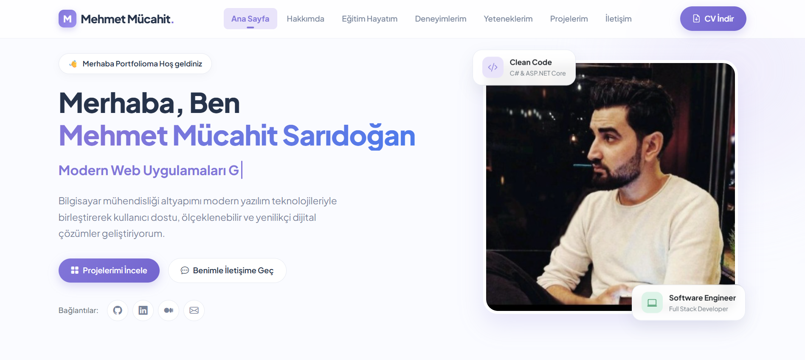
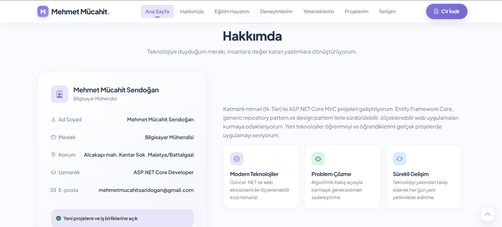
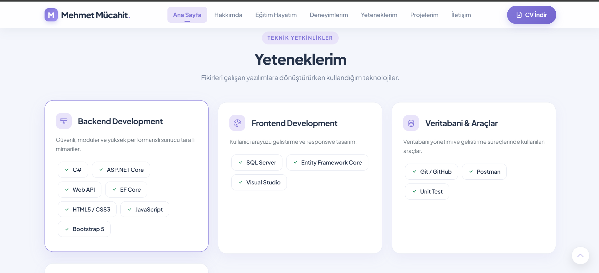
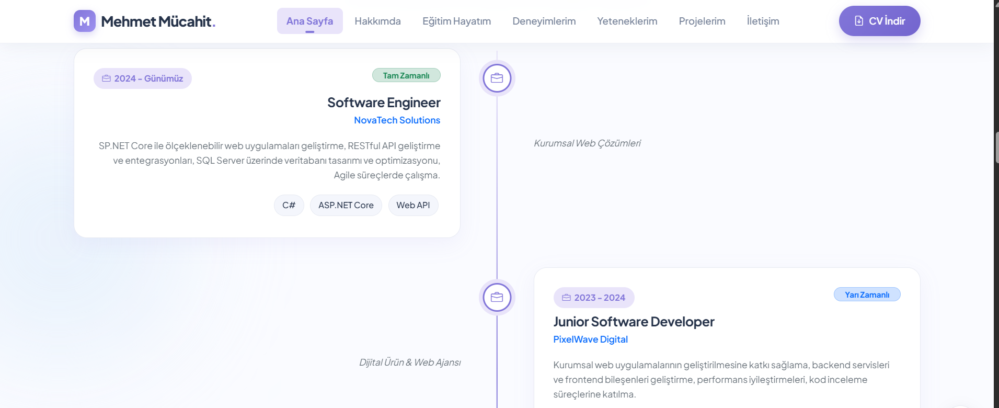
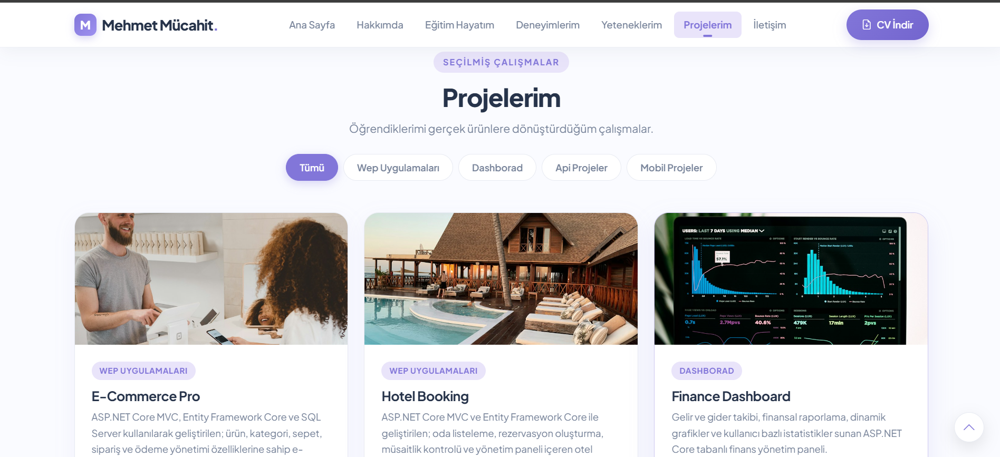
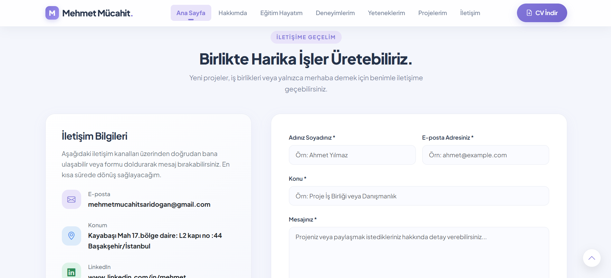
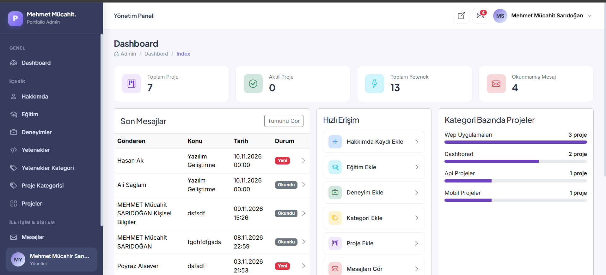
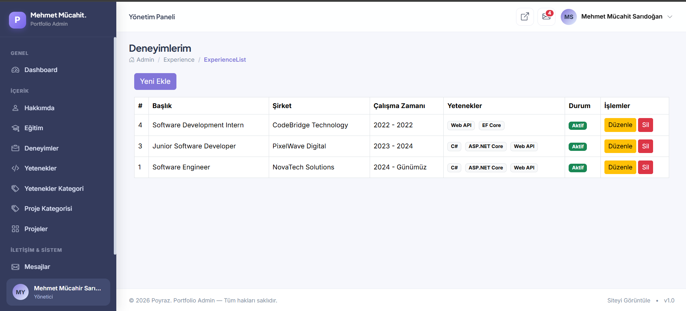
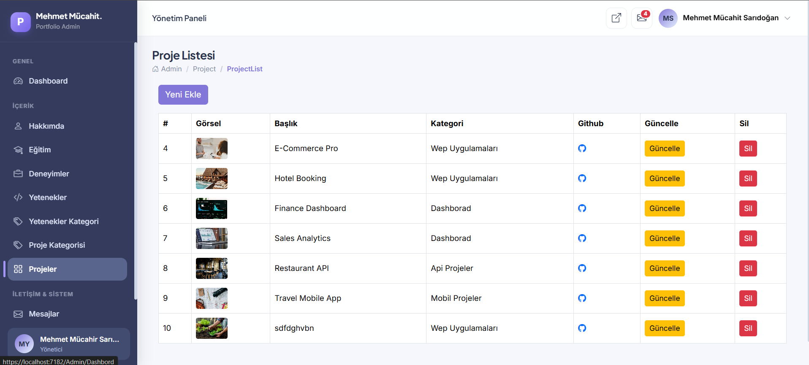

# MyA Portfolio


Admin panelinden uçtan uca yönetilebilen, ASP.NET Core MVC ile geliştirilmiş kişisel portfolyo sitesi. Public tarafın her bölümü (Hero, Hakkımda, Eğitim, Deneyim, Yetenekler, Projeler, İletişim, site ayarları) veritabanından dinamik olarak beslenir; statik içerik yoktur.

> Bu proje bir ASP.NET Core MVC case çalışması (okul ödevi) kapsamında geliştirilmiştir.

## İçindekiler

- [Özellikler](#özellikler)
- [Kullanılan Teknolojiler](#kullanılan-teknolojiler)
- [Ekran Görüntüleri](#ekran-görüntüleri)
- [Proje Yapısı](#proje-yapısı)
- [Kurulum](#kurulum)
- [Notlar](#notlar)

## Özellikler

### Public Site
| Bölüm | Açıklama |
|---|---|
| Hero | Admin'den yönetilen başlık/alt başlık/açıklama/görsel |
| Hakkımda | Kişisel bilgiler + PDF CV indirme |
| Eğitim | Kronolojik eğitim geçmişi |
| Deneyim | Zaman çizelgesi; yalnızca aktif kayıtlar gösterilir, Skill etiketleriyle |
| Yetenekler | SkillGroup bazında gruplanmış, dinamik etiketler |
| Projeler | Kategoriye göre filtrelenebilir proje galerisi (Category ↔ Project many-to-many) |
| İletişim | Sunucu taraflı validation'lı form, başarı/hata geri bildirimi (`TempData`) |
| Site geneli | Sayfa başlığı, meta açıklaması ve footer metni `Settings` kaydından okunur |

### Admin Panel
Area tabanlı (`/Admin`), tüm modüllerde CRUD:

- **Hakkımda** — CV dosyası (PDF) yükleme/güncelleme
- **Eğitim** — tarih alanlı kayıtlar
- **Deneyim** — Skill'lerle many-to-many ilişki, aktif/pasif durumu
- **Yetenek / Yetenek Grubu** — gruplu yönetim
- **Kategori / Proje** — many-to-many ilişki, aktif/pasif durumu
- **Mesajlar** — arama, sıralama, okundu/okunmadı takibi, modal ile silme onayı
- **Site Ayarları** — tek kayıtlı (upsert) yapı: logo, favicon, site başlığı, footer metni
- **Dashboard** — toplam/aktif proje, toplam yetenek, okunmamış mesaj sayısı, kategoriye göre proje dağılımı, son mesajlar, hızlı erişim kısayolları

## Kullanılan Teknolojiler

- **ASP.NET Core MVC** (.NET 10)
- **Entity Framework Core 10** (Code First) + **SQL Server**
- **Bootstrap 5** & **Bootstrap Icons**
- Area tabanlı Admin paneli
- ViewComponent tabanlı, tamamen dinamik public anasayfa

## Ekran Görüntüleri

### Public Site

| Hero | Hakkımda | Yetenekler |
|---|---|---|
|  |  |  |

| Deneyim | Projeler | İletişim |
|---|---|---|
|  |  |  |

### Admin Panel

| Dashboard | Deneyimler | Projeler |
|---|---|---|
|  |  |  |

## Proje Yapısı

```
MyA_Portfolio/
├── Controllers/            # Public site controller'ları (DefaultController)
├── Entities/                # EF Core entity sınıfları
├── Models/                  # Public tarafta kullanılan ViewModel'ler
├── Context/                  # PortfolioContext (DbContext)
├── Migrations/                # EF Core migration geçmişi
├── ViewComponents/             # Public sayfayı oluşturan ViewComponent'ler
├── Views/                        # Public view'ler
├── screenshots/                    # README görselleri (uygulama tarafından kullanılmaz)
└── Areas/
    └── Admin/
        ├── Controllers/
        ├── Models/              # Admin ViewModel'leri
        ├── Views/
        └── ViewComponents/      # Admin layout (sidebar, header, vs.)
```

## Kurulum

1. **Bağlantı dizesini ayarla** — `appsettings.json` içindeki `ConnectionStrings:DefaultConnection` değerini kendi SQL Server/LocalDB bilgine göre düzenle.
2. **Veritabanını oluştur** — Paket Yöneticisi Konsolu'nda:
   ```powershell
   Update-Database
   ```
3. **Projeyi çalıştır** — `F5` ile Visual Studio'dan ya da terminalden:
   ```bash
   dotnet run
   ```
4. **İlk veri girişi** — Admin panelinden (`/Admin/Dashbord`) tek kayıtlı tabloları (About, Contact, HeroSection, Settings) doldur; doldurulmadıkları sürece ilgili public bölümler boş/varsayılan görünür.

## Notlar

- `wwwroot/cv/` ve `wwwroot/settings/` klasörleri, yüklenen dosyalar (CV, logo, favicon) için uygulama tarafından otomatik oluşturulur.
- Admin panelinde tüm silme işlemleri Bootstrap Modal ile onay alınarak yapılır.
- `screenshots/` klasörü yalnızca bu README için kullanılır, uygulama tarafından hiçbir şekilde sunulmaz/okunmaz.
